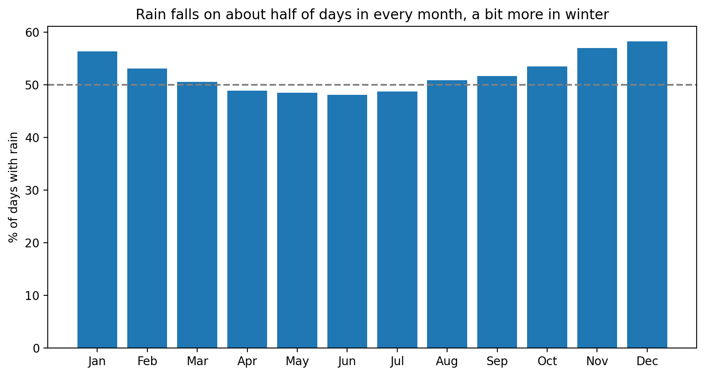
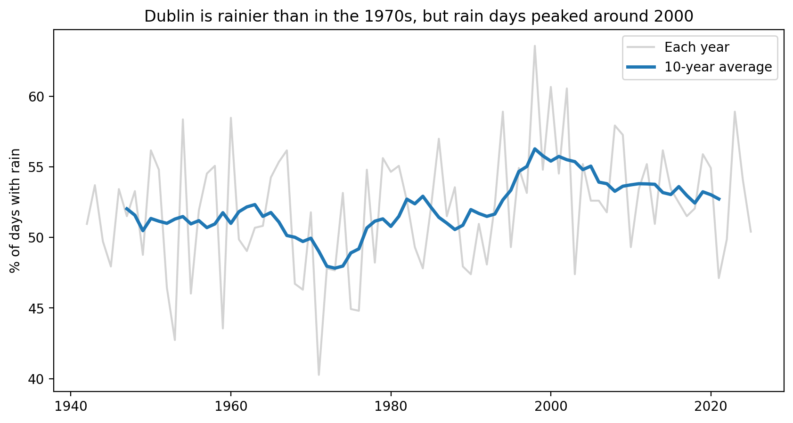
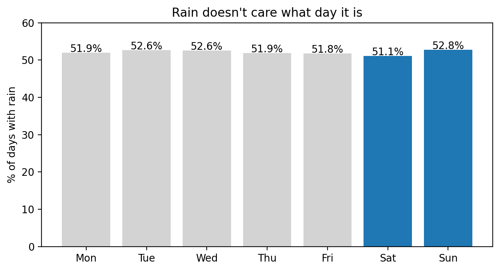
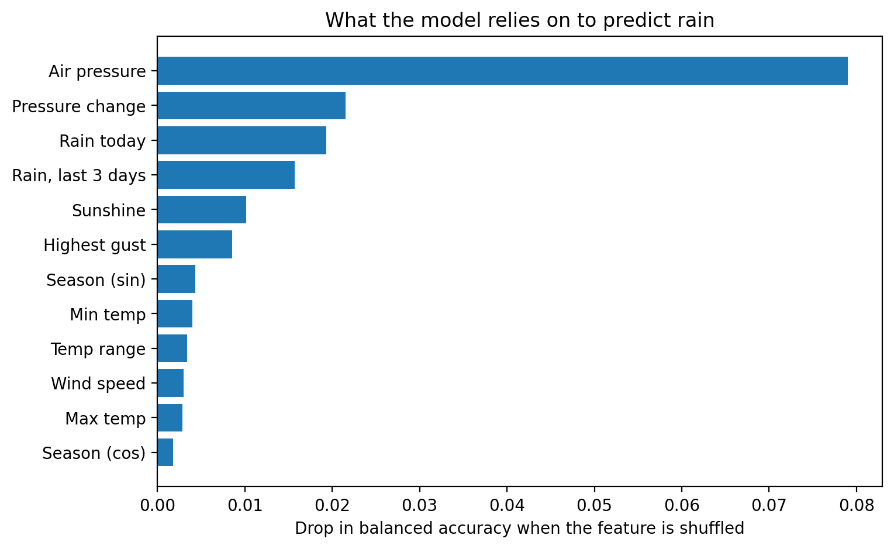

# Is it actually always raining in Ireland?

I analysed 84 years of Met Éireann daily weather data from Dublin Airport to test Ireland's rainy reputation, then built machine learning models to predict whether tomorrow will be wet.

**Tools:** Python, pandas, matplotlib, SciPy, scikit-learn



## Key findings
- It rains on **52%** of days at Dublin Airport, but only **36%** are properly wet (≥1 mm). About a third of rain days are just drizzle.
- **December** has the most rain days (~58%), **June** the fewest (~48%).
- Dublin has about **13–14 more rain days a year** than in the 1940s (p = 0.02), but rain days peaked around 2000 and have eased since.
- Longest rainy streak: **30 days** (May 1967). Longest dry streak: **31 days** (Aug 1947).
- The "it always rains at the weekend" myth is **false** (52.2% vs 51.9%, p = 0.75).
- Rain today makes rain tomorrow almost **twice as likely** (66% vs 37%).





## Can we predict tomorrow's rain?

The target is whether tomorrow will be a wet day (≥1 mm). Models were trained on 1950–2009, tuned on 2010–2016, and tested on 2017–2026.

| Model | Balanced accuracy |
|---|---:|
| Always say "dry" | 50.0% |
| Tomorrow = today | 61.9% |
| Logistic regression | 67.2% |
| Random forest | 67.6% |



Air pressure was by far the strongest signal, about 7× more important than any other feature, followed by pressure change. The simpler logistic regression performed almost as well as the random forest, suggesting the more complex model added little on this dataset. With only one station and daily observations, these results are a useful baseline, not a ceiling on what richer weather data could achieve.

## Method
- Converted blank or whitespace-only measurements to missing values before numeric analysis.
- Tested the long-term trend with linear regression and the weekend effect with a chi-square test.
- Predicted next-day wetness (≥1 mm) using only features available by the end of the current day. The final day, with no known next-day rainfall, was excluded.
- Used a chronological split to keep later years out of training: train 1950–2009, validation 2010–2016, test 2017–2026.
- Selected classification thresholds using validation data only, then evaluated once on the held-out test period.

## Limitations and next steps
- One station only, on Ireland's drier east coast.
- Daily data only, with no humidity or cloud cover.
- The rain-day trend comes from one station and shows change over time, not its cause.
- Next: compare results across more Met Éireann stations, and test whether adding humidity or cloud-cover measurements improves predictions.

## How to run

Install the dependencies:

```bash
pip install -r requirements.txt
```

Then open `notebooks/irish_rain.ipynb` in VS Code or Jupyter and run all cells. The notebook reads the CSV using a path relative to its own folder.

## Data

Met Éireann, Dublin Airport (station 532) daily data, 1 Jan 1942 to 30 Sep 2026. Licensed under [CC BY 4.0](https://creativecommons.org/licenses/by/4.0/). Cleaned and processed by the author. The 2026 record is incomplete.

## Author

Jonathan Kadiri · [jonathankadiri.dev](https://jonathankadiri.dev) · [LinkedIn](https://www.linkedin.com/in/jonathan-kadiri/)